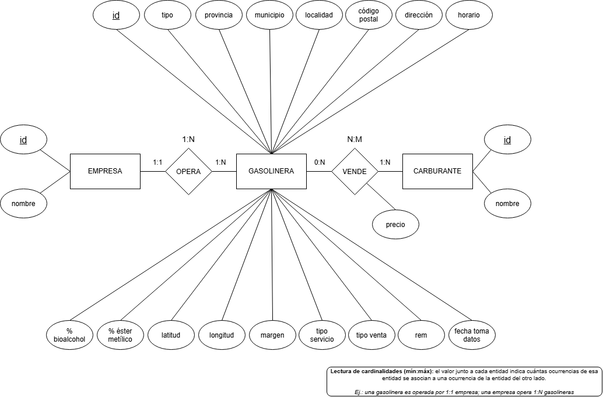

# ETL de precios de carburantes


Proceso ETL en Python que carga en MySQL los precios de carburantes que publica el **Ministerio para la Transición Ecológica y el Reto Demográfico** en su [Geoportal de gasolineras](https://geoportalgasolineras.es/geoportal-instalaciones/DescargarFicheros), tanto de estaciones terrestres como de postes marítimos.

El Ministerio publica los datos en un `.xls` pensado para leerlo a ojo, no para cargarlo en una base de datos: metadatos encima de la cabecera, números con coma decimal, una columna por carburante, columnas sin nombre y nombres de empresa escritos de varias formas. Este proyecto los extrae, los limpia y los guarda en un modelo relacional listo para consultar.

Proyecto de la asignatura *Bases de Datos Avanzadas* (UNIR).

## Stack

| | |
|---|---|
| **Lenguaje** | Python 3.14 |
| **Librerías** | xlrd (lectura de `.xls`), PyMySQL, python-dotenv |
| **Base de datos** | MySQL 8.4 en Docker Compose |
| **Modelado** | draw.io (Chen), Visual Paradigm (relacional), DataGrip |

## Cómo funciona

| Fase | Módulo | Qué hace |
|---|---|---|
| **Extracción** | `etl/extraccion.py` | Abre los `.xls`, localiza la cabecera (sin depender de su posición), limpia los nombres de columna y convierte cada fila en un diccionario |
| **Transformación** | `etl/transformacion.py` | Convierte los textos a `Decimal`, `datetime` o `None`, normaliza los nombres de empresa y separa los precios en filas |
| **Carga** | `etl/carga.py` | Inserta todo en MySQL en una única transacción: o se carga entero, o se deshace |

`etl/ingesta.py` es el punto de entrada y solo marca el orden: extraer → transformar → cargar.

## Modelo de datos

**Modelo conceptual** (notación de Chen):



**Modelo relacional:**


Cuatro tablas: `empresa`, `gasolinera`, `carburante` y `precio`. El precio no es un atributo de la gasolinera ni del carburante, sino de la combinación de los dos, así que vive en la tabla intermedia, con una única fila por cada carburante que la estación vende de verdad. El DDL está en [`sql/esquema.sql`](sql/esquema.sql).

## Decisiones sobre los datos

- **Terrestres y marítimas en la misma tabla**, con una columna `tipo`. Comparten casi todos los atributos; separarlas duplicaría la estructura y la tabla de precios.
- **Los precios pasan de columnas a filas.** Cada estación trae 25 columnas de precio, casi todas vacías. En el fichero del 03/11/2026 eso se queda en 43.093 precios reales.
- **Nombres de empresa normalizados.** El Ministerio escribe a veces el mismo operador con y sin tildes (`ALIARA ENERGIA` / `ALIARA ENERGÍA`), y MySQL los consideraría duplicados. Se quitan las tildes para unificarlos.
- **Empresa `DESCONOCIDA`** para las estaciones sin rótulo y para las variantes que significan lo mismo (`SIN ROTULO`, `(SIN ROTULO)`, `-`, `NO TIENE`, `NINGUNO`).
- **No se inventan datos.** Si un valor no viene (la fecha de toma de datos o el margen en las marítimas, coordenadas que faltan), se guarda como `NULL`.

## Estructura

```
etl-carburantes/
├── data/          # ficheros .xls del Geoportal (foto del 03/11/2026)
├── docs/          # diagramas E-R y resultados de las consultas
├── etl/           # código del ETL
├── sql/           # DDL del esquema y consultas de análisis
├── docker-compose.yml
├── requirements.in / requirements.txt
└── .env.example
```

## Cómo ejecutarlo

Requisitos: Python 3.14 y Docker.

```bash
# 1. Entorno virtual y dependencias
python -m venv .venv
.venv\Scripts\activate          # Windows  (en Linux/macOS: source .venv/bin/activate)
pip install -r requirements.txt

# 2. Variables de entorno: copia la plantilla y pon tus contraseñas
copy .env.example .env          # Windows  (en Linux/macOS: cp .env.example .env)

# 3. Levantar MySQL
docker compose up -d
```

4. Crear las tablas ejecutando `sql/esquema.sql` con tu cliente de MySQL (DataGrip, DBeaver o `mysql`).
5. Lanzar la ingesta desde la raíz del proyecto:

```bash
python -m etl.ingesta
```

## Consultas

Las cinco preguntas de la actividad están en [`sql/consultas.sql`](sql/consultas.sql), y sus resultados exportados en [`docs/resultados_consultas/`](docs/resultados_consultas/). Con los datos del 03/11/2026:

| Pregunta | Respuesta |
|---|---|
| Empresa con más estaciones terrestres | REPSOL, con 2.753 |
| Empresa con más estaciones marítimas | REPSOL, con 70 de 135 |
| Gasolina 95 E5 más barata en Madrid | Cuatro estaciones empatadas a 1,499 €, en Valdemoro |
| Gasóleo A más barato a menos de 10 km del centro de Albacete | PLENERGY, C/ Federico García Lorca 1: 1,729 € a 0,746 km (la más cercana de cuatro empatadas) |
| Provincia de la estación marítima con la Gasolina 95 E5 más cara | PONTEVEDRA, a 2,200 € |

Las distancias se calculan en línea recta con `ST_Distance_Sphere`, no por carretera. Los empates se han comprobado ejecutando cada consulta sin `LIMIT`.

## Hoja de ruta

- [x] Extracción de los `.xls`
- [x] Transformación y normalización
- [x] Modelo conceptual, modelo relacional y DDL
- [x] Carga de empresas y carburantes
- [x] Carga de gasolineras y precios
- [x] Consultas SQL de análisis

## Licencia

[MIT](LICENSE)
